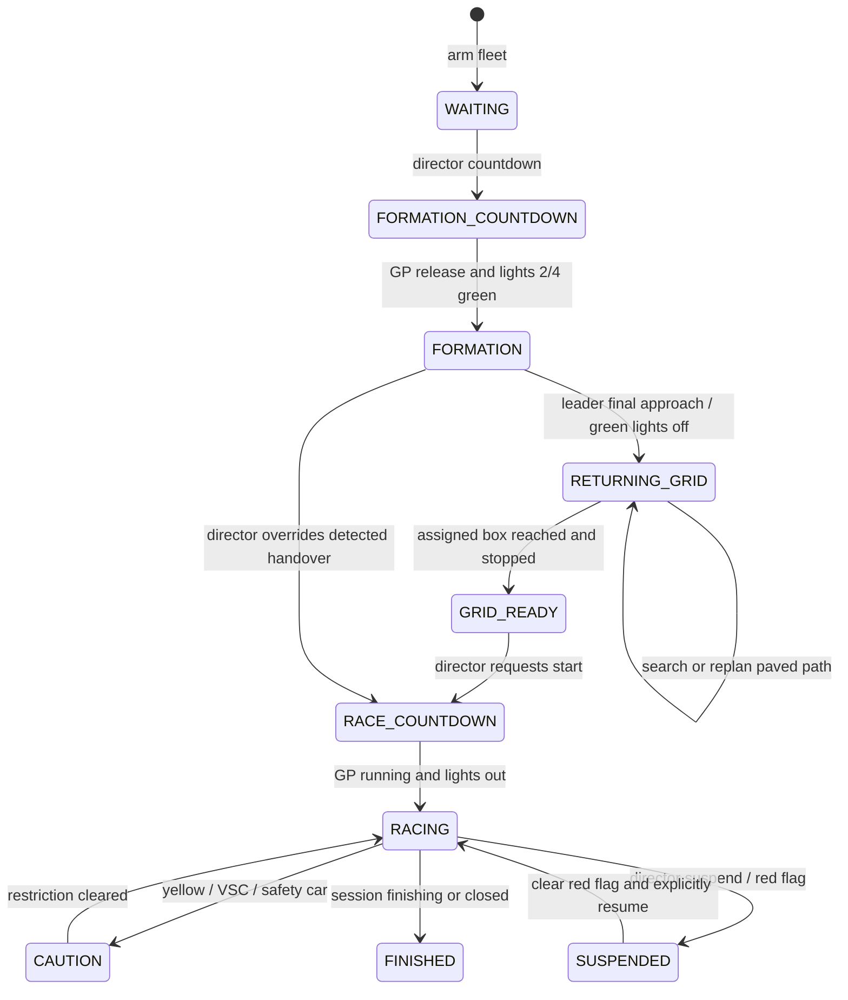

# Procedural AI Race Control

## Authority and states

`AiRaceProcedure` owns sporting permission per car. The racing-line planner remains responsible for route geometry and grip-limited pace; its throttle command is only used after the procedure grants movement.

- `/owr ai fleet start` arms cars. It does not authorize racing from a default green flag.
- Without a GP, cars require a fresh red-light sequence followed by lights-out (`startPhase=6`). Arming while an old lights-out value remains set does not release them. Formation green (`7`) grants formation pace only; another red-light sequence is needed to race afterward.
- With a GP, configured/open/staged/countdown sessions hold cars. Only registered, entered drivers on the correct track are admitted. Retired or replaced cars cannot resume racing through a mode override.
- GP formation requires both the formation lifecycle phase and formation-green lights. GP racing requires both `RUNNING` and lights-out. Practice/qualifying also follow their explicit session start.
- GP suspension and restart recovery require a director resume. Red flags suspend the GP sporting clock as well as braking AI cars; clear the red flag before resuming. In-progress lap intervals are cleared to exclude stopped time.
- `race`, `formation`, `vsc`, and other pace overrides cannot bypass a stopped procedure, red flag, or slower flag restriction. Unknown localization stops the car.
- Driver status includes `procedure=<state>` and reports grid faults. Intentional holds do not advance controller lap/training clocks or trigger stalled-car recovery.

## Countdown timing

- The configurable session countdown applies only to formation preparation, with one red light per ten remaining seconds.
- After formation, race start restores the traditional light sequence: first red immediately, then a second, third, fourth, and fifth red at one-second intervals. The existing randomized lights-out delay belongs to the fifth-light phase; all five stay red until they go out together. There is no separate countdown after this sequence. GP and standalone lights share the same per-phase timing rule. The sampled final-light delay persists through suspension/recovery and is never re-rolled on resume.
- Start/Lights out still permits the director to release immediately. Grid detection cannot veto countdown or release.

## Formation heating

- Formation green selects `FORMATION_HEATING`, distinct from yellow-flag `FORMATION` pace. Suitable straights target 200 km/h. Formation heating bypasses the gentle acceleration governor and requests full throttle/full braking when alignment, pavement, and the remaining friction budget permit; flags, traffic, and following distance still take priority.
- A continuous-phase sinusoid adds up to ±0.8 m lateral weave around the learned line. Wavelength adapts between 24 and 180 m to target 75% of available lateral grip, with a one-second intensity build-up. Amplitude is reduced where necessary to stay inside that budget. Full car footprints must fit on paved, unobstructed track at the weave envelope and ahead.
- Weaving is disabled near other cars, while braking, before corners, and on narrow pavement. The offset returns gradually to the base line rather than snapping sideways.
- Corner speeds use 70% of the current lateral grip envelope, up to the 200 km/h formation ceiling. Tighter, colder, or lower-grip corners reduce speed automatically; there is no fixed 79 km/h cap on every bend. Corner recognition averages signed curvature over 24 m so small recorded steering corrections do not masquerade as bends. The preview uses 90% of available braking capability with a 0.35 s reaction allowance for strong braking before the corner. The 200 km/h figure is a straight-line target, not an imposed velocity.
- Yellow, VSC, safety-car, and red restrictions retain priority and disable the heating-specific weave.

- Steering is bounded by the bicycle-model angle for the current speed and available lateral acceleration, permitting full lock only at sufficiently low speed. Longitudinal and lateral demands share a 90% friction ellipse; longitudinal input is reduced as lateral demand rises, preserving both steering and deceleration. Collision avoidance can always demand an emergency stop. Aggressive throttle is disabled when the car is misaligned or lacks a clear paved lane.

## Grid return

- The first **Stage** command explicitly places assigned cars in their grid slots. A director can also re-stage a grid before race start; that action preserves the completed formation phase.
- After formation handover, each nearby car searches for a paved local path to an approach point 8 m behind its assigned box, then the box itself. It does not require survey localization or predecessor queue data during local navigation.
- `AiGridPathSearch` uses forward-only 4 m motion primitives and ±22.5° heading steps, checking swept car footprints against loaded paved surfaces, block collision shapes, and parked car bodies. Each footprint queries the local road top, including slab/height transitions; clearance is not evaluated at a fixed current-car height. Search is bounded to 12,000 expanded nodes and 220 m from the car, with a fleet budget of 384 expansions/tick and at most 64 per car/tick. Clear straight approaches use a validated shortcut.
- Cars farther than 180 m from their boxes continue route following until local navigation can take over. Search handles offset grid rows and obstacles; the path follower caps local speed at 8 m/s and uses measured feedback targeting 1 m/s² acceleration.
- Failed searches stop and retry after 5 seconds. Missed waypoints, changed obstacles, and overshot approaches cause replanning instead of a permanent missed-grid fault. Search failure never causes an unsafe straight drive across runoff or barriers. Moving/held AI cars retain a ticking chunk core around their actual world position, independently of survey progress.
- Collision prediction uses metres per second consistently and extends its lookahead at high speed. Formation following also uses predecessor speed and available braking distance rather than only a proportional gap penalty.
- Docking avoidance uses actual body-scale clearances (5.7 m longitudinal, 2 m lateral) and a 0.5 s horizon so legally spaced parked cars do not trigger the larger racing clearance and block grid entry.
- Position/heading/speed readiness remains useful to the AI for stopping in its box. It is **not a veto on the race director**. The director may request Countdown during formation without waiting for the final-100 m detector, and may use Start/Lights out during race countdown to release immediately. Automatic countdown expiry also proceeds without a grid-readiness check.

## Motion and learning bounds

- Yellow-flag formation and safety-car acceleration is capped at 1.5 m/s²; VSC at 2 m/s². Race acceleration remains governed by the existing grip/pace planner.
- The acceleration governor learns throttle from observed speed change, compensating for actual engine/gear output and drag rather than imposing a throttle fraction from idealized peak power. Emergency/collision braking retains priority. Non-finite drive commands fail to zero throttle and full brake.
- Recovery is permitted only while racing or under caution, and not while queued closely behind another car. Formation, grid approach, waiting, countdown, suspension, and finished states never trigger automatic stalled recovery.
- Formation and race legs reset controller progress at their actual releases. Clearing a caution does not restart the race launch algorithm. Learning collectors are cleared whenever the car is not in unrestricted racing.

## Player telemetry learning

- The planner selects the fastest valid full player line for the active track and survey revision, applies 95% of its lateral offset within the existing track envelope, and aims for player speed divided by 1.03 subject to grip and braking bounds.
- New laps with block or entity impacts are not committed as learning profiles; their lap times/telemetry remain available to the recorder. Partial, invalidated, and insufficient-coverage traces cannot become references. Collision-free subsequent laps can teach normally.
- Older saved profiles have no historical collision flag. This change prevents new crashed traces from entering learning; it cannot retrospectively prove whether an old recording was crash-free. Invalidating an old lap removes its associated profile through the existing recorder controls.
- Plan caches are rebuilt when reference profiles change or grip/braking capability changes materially.

## Verification

Unit tests include a kinematic grid-docking simulation, obstructed path search, bounded search/retry, heating/weave/corner limits, and clean-versus-impacted profile capture. They also exercise the complete standalone and GP sequences, stale lights, session changes, eligibility/localization loss, every lifecycle/light/override combination against red flags, flag pace bounds, assigned-order following, grid geometry/readiness, braking targets, finite command bounds, and frozen hold clocks. Use `./gradlew build` for standard and livery checks. Physical heating and docking still need an in-game check on the authored circuit.

## Runtime diagnosis

The fleet logs `controller=terrain-feedback-v2` when armed, and `OWR AI motion` per car every five seconds with procedure, mode, actual/target speed, throttle, brake, gear, RPM, position, and grid-search/blocking reason. A currently running client must be fully restarted to load changed Java classes; a Gradle rebuild alone cannot update an already loaded controller.
